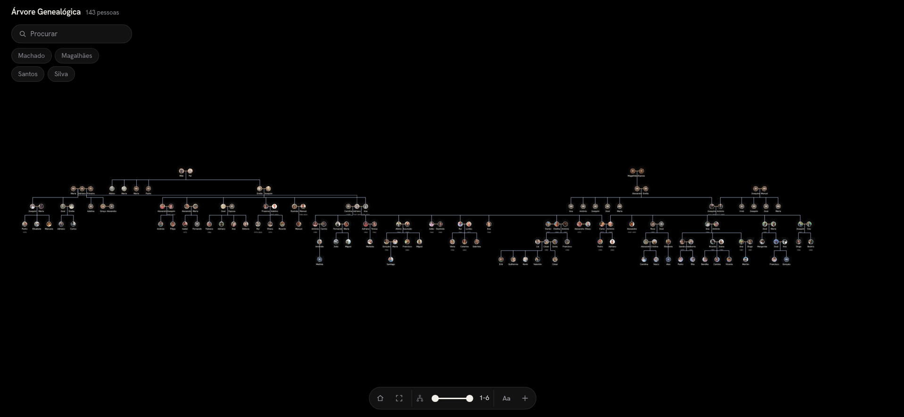

# Family tree

A family tree the whole family can browse and edit in the browser. Each person is a small portrait; lines join parents to children and partners to each other. Select someone to read their story and see their photos.

**Online at [tree.adrianomachado.pt](https://tree.adrianomachado.pt)**



## What it does

- **Browse**: drag and zoom around the tree, jump back to your own household, or fit the whole tree on screen.
- **Search**: find anyone by name or nickname, or by words in their story.
- **Filter**: show one side of the family (each has its own address, like `/machado`), a range of generations, one person's lineage (ancestors and descendants) or all of their relatives.
- **Kinship**: pick two people and the site says how they are related.
- **Person panel**: dates, birthplace, parents, partners, children, siblings, godparents and godchildren, a story and a photo gallery.
- **Edit in the site**: add and change people and photos without touching a file, shared with the family through a free Supabase database.

## Run it

```
npm install
npm run dev
```


